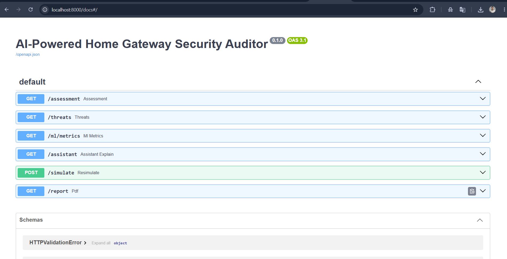
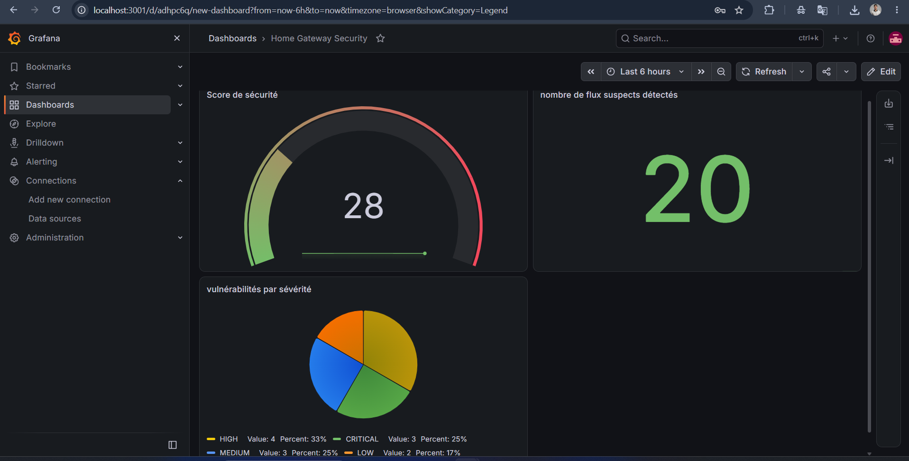
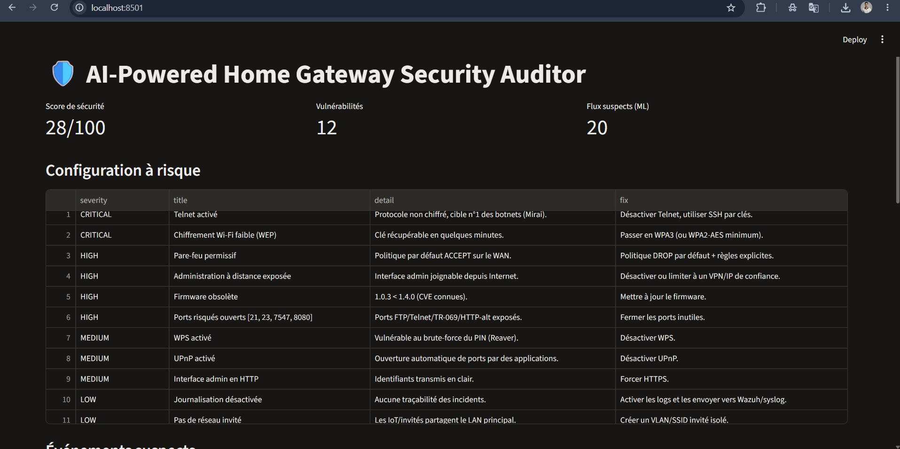

# AI-Powered Home Gateway Security Auditor

Plateforme d'audit de Home Gateway : checks de configuration + détection ML (Random Forest) + assistant LLM + dashboard + rapport PDF.

## Lancer
```bash
export ANTHROPIC_API_KEY=...   # optionnel : sans clé, l'assistant utilise un mode règles
docker compose up --build
```
- API & Swagger : http://localhost:8000/docs  (`/assessment`, `/threats`, `/assistant`, `/report`, `/metrics`)
- Dashboard Streamlit : http://localhost:8501
- Prometheus : http://localhost:9090 — Grafana : http://localhost:3000 (source Prometheus `http://prometheus:9090`, métriques `gateway_*`)

## Local sans Docker
```bash
pip install -r requirements.txt && python -m sim.simulate && python -c "from app import ml; ml.train()"
uvicorn app.main:app --reload & streamlit run dashboard.py
```

## Pistes d'extension (CV)
Remplacer les données simulées par des captures **Mininet + Wireshark/tshark** (features par flux), ingérer des alertes **Wazuh** (API REST), ajouter SHAP pour l'explicabilité, dashboard Grafana provisionné en JSON.

## Captures d'écran





## Limites
Les données (configuration et trafic) sont **simulées**. Les scores du modèle (F1 ≈ 1,0) valident la chaîne de bout en bout, pas une performance sur du trafic réel.
